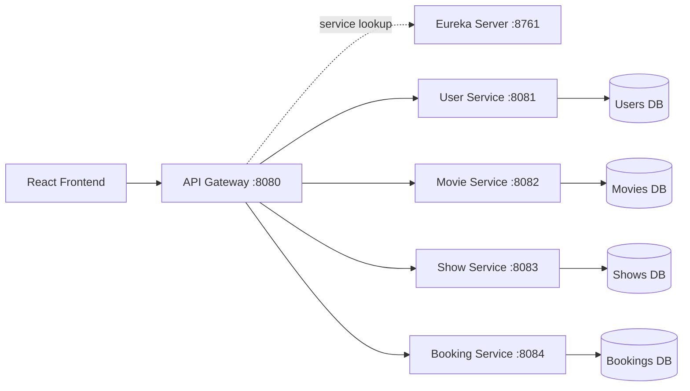
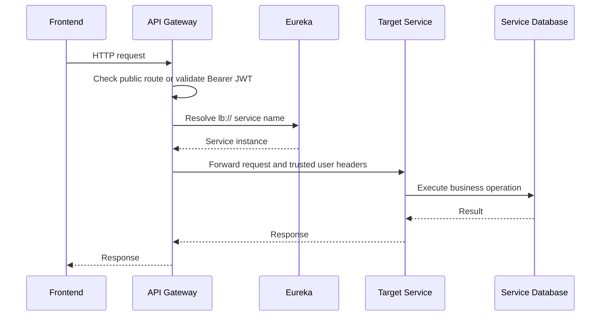

# CinePass Backend Workflow

## Problem and requirements

Cinema booking needs to coordinate users, movies, showtimes, seats, and ticket verification without placing every responsibility in one application. The backend is therefore organized around business capabilities and exposes one controlled entry point to the frontend.

The design goals are:

- independently deployable business services
- service discovery instead of hard-coded service locations
- JWT authentication at the edge
- protected booking operations
- safe concurrent seat allocation
- separate persistence for each business area
- local development and container deployment paths

## Backend topology



## Microservice responsibilities

| Service | Responsibility | Discovery name | Local port |
| --- | --- | --- | ---: |
| Eureka Server | Registers and locates service instances | `eureka-server` | 8761 |
| API Gateway | Routing, CORS, JWT enforcement, edge contract | `api-gateway` | 8080 |
| User Service | Registration, password verification, JWT issuance, profile | `user-service` | 8081 |
| Movie Service | Movie catalogue | `movie-service` | 8082 |
| Show Service | Showtimes and cinema scheduling | `show-service` | 8083 |
| Booking Service | Seats, bookings, payment state, QR tickets | `booking-service` | 8084 |

Each Spring Boot service registers with Eureka. The gateway routes using logical names such as `lb://user-service`, so the client does not need to know backend hostnames or instance addresses.

## Request workflow



## JWT authentication

1. The user registers or logs in at the User Service.
2. Passwords are stored as hashes; the raw password is not returned.
3. `JwtService` signs a token containing the user id, email subject, name, issue time, and expiration.
4. The frontend sends the token as `Authorization: Bearer <token>`.
5. `JwtAuthFilter` validates the signature and token claims at the gateway.
6. The gateway forwards trusted `X-User-Id` and `X-User-Email` headers to downstream services.
7. Missing, malformed, expired, or invalid tokens receive HTTP 401.

Public routes are limited to authentication endpoints, catalogue/show browsing routes, ticket verification, seat availability, CORS preflight, and health endpoints. Booking mutations and user profile access require authentication.

## Gateway configuration

The gateway exposes a stable public contract:

```yaml
/api/users/**    -> lb://user-service
/api/movies/**   -> lb://movie-service
/api/shows/**    -> lb://show-service
/api/bookings/** -> lb://booking-service
```

CORS is configured at the gateway, and the production profile externalizes the JWT secret, Eureka URL, and allowed frontend origins. The browser never needs direct access to internal service ports.

## Booking consistency

The booking flow protects the most important business invariant: one seat cannot be sold twice. The implementation uses pessimistic locking together with a unique `(showId, seatNumber)` constraint. This gives a database-backed safeguard when concurrent requests target the same show and seat.

## Runtime and delivery

Local development starts Eureka before the gateway and business services. Docker Compose adds PostgreSQL, health checks, service dependencies, production profiles, and a compiled Nginx frontend. The main runtime path is:

```text
PostgreSQL -> Eureka -> business services -> API Gateway -> Nginx/React frontend
```

## Backend evidence

- Gateway routes: `backend/api-gateway/src/main/resources/application.yml`
- Gateway JWT enforcement: `backend/api-gateway/src/main/java/com/cinepass/gateway/JwtAuthFilter.java`
- Token issuance: `backend/user-service/src/main/java/com/cinepass/user/JwtService.java`
- Login and registration: `backend/user-service/src/main/java/com/cinepass/user/AuthController.java`
- Container topology: `docker-compose.yml`
- Local startup order: `start-cinepass.bat`
