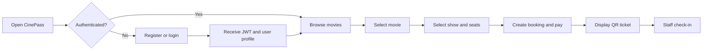

# CinePass Frontend Workflow

## Purpose

The CinePass frontend is a React and Vite single-page application for customers and cinema staff. It provides the user-facing workflow while keeping business rules and persistence in the backend services.

## Technology and deployment

- React with Vite
- Development URL: `http://localhost:5173`
- Container URL: `http://localhost:3000`
- Nginx serves the production build and proxies `/api/` to the API Gateway
- Browser session data is stored under `cinepass.token` and `cinepass.user`

## End-to-end user workflow



1. The user opens the React application.
2. The user registers or logs in through `/api/users/register` or `/api/users/login`.
3. The frontend stores the returned token and profile in browser storage.
4. The user browses movies and shows through the gateway.
5. The user selects a show and seats, then submits the booking.
6. The application displays the booking confirmation and QR ticket.
7. Staff can use `/check-in` to verify a ticket.

## Frontend-to-backend contract

The shared API helper in `frontend/src/api.js` adds `Content-Type: application/json` and, when available, sends:

```http
Authorization: Bearer <jwt>
```

The frontend calls the gateway using these resource groups:

| Frontend responsibility | Gateway path | Backend service |
| --- | --- | --- |
| Register, login, profile | `/api/users/**` | User Service |
| Browse movie catalogue | `/api/movies/**` | Movie Service |
| Browse showtimes | `/api/shows/**` | Show Service |
| Seats, bookings, tickets | `/api/bookings/**` | Booking Service |

In Docker, Nginx keeps the browser on one origin and forwards API requests internally to `api-gateway:8080`. This avoids exposing each backend service directly to the browser.

The frontend does not need to know Eureka or individual service locations. The API Gateway uses Eureka service discovery behind the `/api` contract, keeping discovery and routing concerns out of the browser.

## Demonstration script

1. Start the project with `start-cinepass.bat` or Docker Compose.
2. Open the frontend URL.
3. Register a new account and confirm that login returns a session.
4. Browse a movie and showtime.
5. Select seats and complete a booking.
6. Refresh the page to demonstrate session restoration.
7. Open the staff check-in screen and verify the generated QR ticket.

## Frontend quality points

- Clear separation between presentation and backend business logic
- One API helper for consistent request and error handling
- Protected requests automatically carry the JWT
- SPA fallback routing is configured in Nginx
- Development and container deployment use the same `/api` contract

## Frontend evidence

- API/session behavior: `frontend/src/api.js`
- Browser application: `frontend/src/App.jsx`
- Styling: `frontend/src/styles.css`
- Production proxy: `frontend/nginx.conf`
- Container build: `frontend/Dockerfile`
